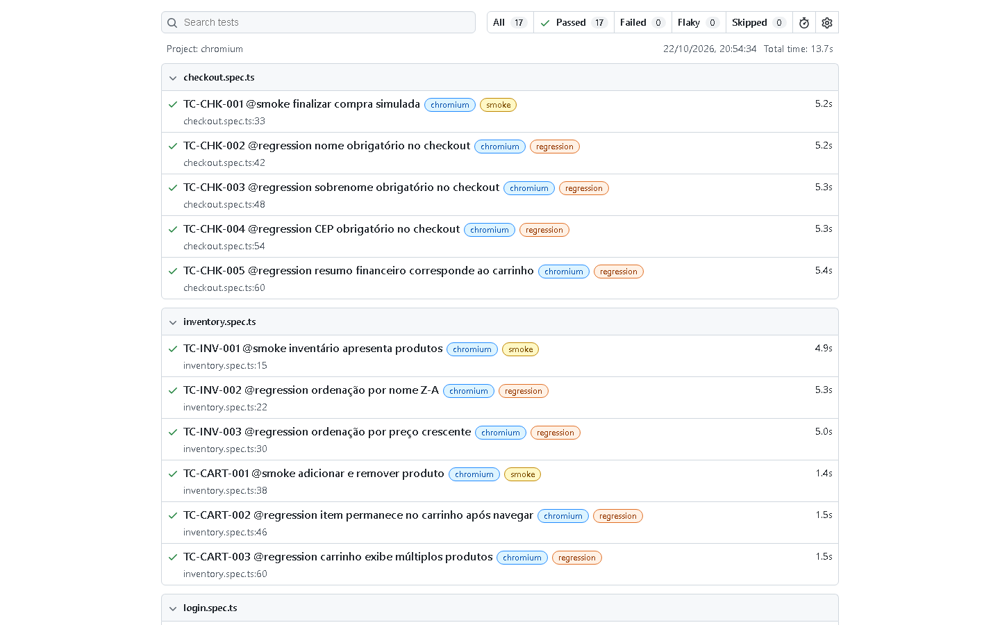

# QA Automation Portfolio | SauceDemo

[](https://github.com/jvcim/qa-playwright-saucedemo/actions/workflows/playwright.yml)


Projeto de portfólio de QA Automation para a aplicação pública de demonstração [SauceDemo](https://www.saucedemo.com/). Ele reúne planejamento e estratégia de testes, automação E2E com Playwright e TypeScript, Page Object Model, rastreabilidade com Jira, integração contínua no GitHub Actions e evidências reais de execução.

> Projeto de estudo independente. Não possui afiliação com Sauce Labs e não realiza pagamentos reais.

## Resultado em destaque

| Indicador | Evidência |
| --- | --- |
| Cenários E2E | 17, distribuídos em autenticação, inventário, carrinho e checkout |
| Última validação local documentada | 17 Passed, 0 Failed, em 13,7 s no Chromium (22/10/2026) |
| Perfis de execução | 4 smoke e 13 regression |
| Qualidade técnica | TypeScript validado com `tsc --noEmit` |
| CI | Workflow Playwright executado em push e pull request para `main` |
| Gestão | 4 histórias, 17 Test Cases e 6 tarefas técnicas rastreados no Jira |

## Cobertura funcional

| Módulo | Casos | O que é verificado |
| --- | ---: | --- |
| Autenticação | 6 | Login válido, mensagens de validação, usuário bloqueado e logout |
| Inventário | 3 | Disponibilidade dos produtos e ordenação por nome e preço |
| Carrinho | 3 | Adição, remoção, persistência e múltiplos itens |
| Checkout | 5 | Finalização simulada, campos obrigatórios e resumo financeiro |
| **Total** | **17** | **Fluxos críticos de uma jornada de compra simulada** |

## Evidência visual de execução

A imagem abaixo foi capturada diretamente do relatório HTML gerado pela validação local de 22/10/2026. Ela mostra o filtro de 17 testes aprovados; não é uma simulação de resultado.



O histórico e o contexto técnico estão no [relatório de execução](docs/EXECUTION_REPORT.md). Em falhas, a configuração também preserva screenshot, vídeo e trace; como a execução documentada foi aprovada, não houve artefatos de falha.

## Arquitetura de automação

```text
tests/                  Cenários E2E identificados por TC-XXX-000
pages/                  Page Objects: Login, Inventário, Carrinho e Checkout
utils/                  Massa pública de teste e conversão monetária em centavos
docs/                   Plano, catálogo, rastreabilidade, evidências e caso de estudo
.github/workflows/      Pipeline de typecheck e Playwright no GitHub Actions
```

Os testes descrevem o comportamento esperado; os Page Objects centralizam locators e ações de cada tela. No resumo financeiro, por exemplo, o subtotal é calculado a partir dos preços coletados antes do checkout em centavos — sem depender de arredondamento de ponto flutuante — e confrontado com o resumo da aplicação.

## Gestão de qualidade e Jira

O Jira foi usado para organizar quatro histórias funcionais, Test Cases como subtarefas nativas e seis tarefas técnicas. Cada caso possui um ID estável (`TC-AUTH-001` a `TC-CHK-005`) e ligação entre requisito, automação e evidência. O quadro operacional é privado para preservar a instância pessoal, mas seu estado final está documentado no [snapshot público do Jira](docs/JIRA_PROJECT_SNAPSHOT.md).

Para uma leitura por públicos diferentes:

- [Caso de estudo](docs/PORTFOLIO_CASE_STUDY.md) — visão executiva do problema, estratégia e resultado.
- [Plano de testes](docs/TEST_PLAN.md) — escopo, riscos e critérios.
- [Catálogo de testes](docs/TEST_CATALOG.md) — objetivos, massa e classificação dos 17 casos.
- [Matriz de rastreabilidade](docs/TRACEABILITY_MATRIX.md) — ligação entre requisito, ticket, teste e evidência.
- [Relatório de execução](docs/EXECUTION_REPORT.md) — resultados reais registrados.

## Integração contínua

O workflow [Playwright E2E](.github/workflows/playwright.yml) roda typecheck e a suíte Chromium em cada `push` ou `pull request` para `main`. O relatório HTML é publicado como artefato. Uma execução aprovada da versão de 17 casos está disponível na [run #4 do GitHub Actions](https://github.com/jvcim/qa-playwright-saucedemo/actions/runs/39528450078).

## Executar localmente

Pré-requisitos: Node.js LTS e npm ou pnpm.

```bash
npm install
npx playwright install chromium
npm run check
```

Comandos úteis:

```bash
npm run test:smoke
npm run test:regression
npm run report
```

Alternativa com pnpm:

```bash
pnpm install --frozen-lockfile
pnpm exec playwright install chromium
pnpm run check
```

As credenciais padrão são públicas e fornecidas pelo SauceDemo. Para substituí-las, defina `STANDARD_USER`, `STANDARD_PASSWORD` e, opcionalmente, `BASE_URL` no ambiente. Nunca registre credenciais pessoais no repositório.
