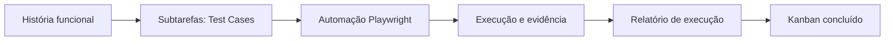

# Snapshot Público do Jira — SauceDemo QA Engineering

## Propósito

Este documento é o retrato público final da gestão do projeto no Jira. Ele permite que recrutadores e pessoas sem acesso à instância Jira entendam o planejamento, a rastreabilidade e o resultado do trabalho sem expor o quadro pessoal do autor.

> Fonte: projeto `SDQAE — SauceDemo | QA Engineering Board`. Snapshot de encerramento em 20/10/2026. O Jira operacional permanece privado; este arquivo é a evidência pública versionada junto ao código.

## Resumo executivo

| Indicador | Resultado |
| --- | --- |
| Tickets no escopo | 27 |
| Histórias funcionais | 4 |
| Casos de teste como subtarefas | 17 |
| Tarefas técnicas | 6 |
| Casos aprovados | 17 / 17 |
| Bugs confirmados | 0 |
| Estado final do Kanban | Todos os tickets em `Concluído` |
| Labels no Jira | Nenhuma |

## Como o trabalho foi organizado

O Kanban representa o andamento do trabalho: `Planejado → Em andamento → Em validação → Concluído`. O resultado de qualidade é registrado separadamente em cada Test Case, com os valores `Pass`, `Fail`, `Blocked` ou `Not Run`. Assim, concluir um ticket não é automaticamente sinônimo de aprovar um teste.

Nesta entrega, todos os 17 Test Cases receberam resultado real `Pass`; por isso, também puderam ser encerrados no Kanban.

## Histórias e casos de teste

| História | Escopo validado | Test Cases aprovados |
| --- | --- | --- |
| `SDQAE-1` — Autenticação | Login válido, credenciais inválidas, campos obrigatórios, usuário bloqueado e logout | TC-AUTH-001 a TC-AUTH-006 |
| `SDQAE-2` — Inventário | Listagem, ordenação Z-A e ordenação de preço crescente | TC-INV-001 a TC-INV-003 |
| `SDQAE-4` — Carrinho | Adição/remoção, persistência e múltiplos produtos | TC-CART-001 a TC-CART-003 |
| `SDQAE-3` — Checkout | Finalização simulada, obrigatoriedade e resumo financeiro | TC-CHK-001 a TC-CHK-005 |

### Resultado consolidado por funcionalidade

| Funcionalidade | Casos | Pass | Fail | Blocked |
| --- | ---: | ---: | ---: | ---: |
| Autenticação | 6 | 6 | 0 | 0 |
| Inventário | 3 | 3 | 0 | 0 |
| Carrinho | 3 | 3 | 0 | 0 |
| Checkout | 5 | 5 | 0 | 0 |
| **Total** | **17** | **17** | **0** | **0** |

## Tarefas técnicas concluídas

| Ticket | Entrega |
| --- | --- |
| `SDQAE-15` | Documentação, catálogo, matriz de rastreabilidade e apresentação do projeto |
| `SDQAE-16` | Execução e validação da suíte Playwright |
| `SDQAE-17` | Investigação de falhas — não aplicável, pois nenhum defeito real foi identificado |
| `SDQAE-18` | Validação da integração contínua no GitHub Actions |
| `SDQAE-19` | Consolidação de evidências de execução |
| `SDQAE-20` | Relatório final e publicação do portfólio |

## Evidências verificáveis

- Execução local final: **17 Passed, 0 Failed, 0 Blocked** em Chromium.
- TypeScript validado com `tsc --noEmit`.
- [Relatório detalhado de execução](EXECUTION_REPORT.md).
- [Matriz de rastreabilidade](TRACEABILITY_MATRIX.md).
- [Run #4 do GitHub Actions](https://github.com/jvcim/qa-playwright-saucedemo/actions/runs/39528450078) concluída com sucesso e artefato `playwright-html-report`.

## Decisões de governança

- O Jira pessoal não é aberto ao público para evitar expor a instância e exigir acesso de terceiros.
- Este snapshot é mantido no repositório para que o estado do Jira seja verificável em uma leitura pública.
- Não foram usadas labels no Jira; a identificação ocorre pelos IDs dos casos e pelas relações com as histórias.
- Nenhum Bug foi criado porque não houve defeito confirmado durante as execuções registradas.

## Leitura recomendada

1. [Caso de estudo do portfólio](PORTFOLIO_CASE_STUDY.md) para a visão executiva.
2. Este snapshot para entender a gestão e o estado final do Jira.
3. [Catálogo de testes](TEST_CATALOG.md) e [matriz de rastreabilidade](TRACEABILITY_MATRIX.md) para o detalhamento técnico.
