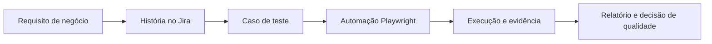
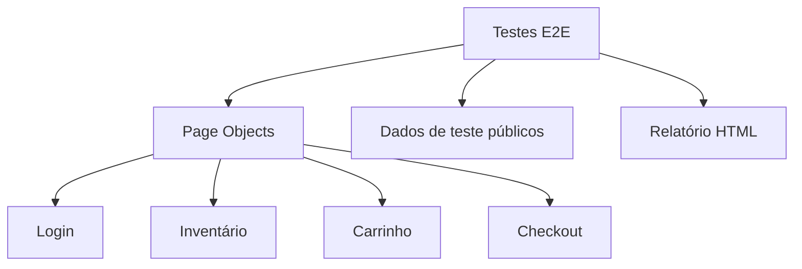

# SauceDemo — Caso de Estudo de QA Engineering

## Visão executiva

Este projeto demonstra como Quality Assurance contribui para a confiança de uma aplicação antes de uma entrega. A aplicação avaliada é o SauceDemo, uma loja virtual pública de demonstração. O trabalho transforma requisitos funcionais em cenários verificáveis, automação reproduzível, evidências de execução e acompanhamento pelo Jira.

O objetivo não é somente “rodar testes”: é deixar claro o que foi validado, por que foi validado, qual foi o resultado e onde consultar cada evidência.

## Resultado em destaque

| Indicador | Resultado |
| --- | --- |
| Funcionalidades cobertas | Autenticação, inventário, carrinho e checkout |
| Casos automatizados | 17 |
| Última execução local | 17 Passed, 0 Failed, 0 Blocked |
| Tempo da última suíte | 12,2 s no Chromium |
| Defeitos confirmados | Nenhum nas execuções registradas |
| Gestão do trabalho | Jira Cloud, projeto SDQAE |
| Integração contínua | GitHub Actions |

> Os resultados de execução refletem testes reais contra o ambiente público de demonstração. Não há resultados fictícios neste projeto.

## O problema que o projeto resolve

Uma loja virtual depende de fluxos simples, mas críticos: entrar na conta, consultar produtos, montar o carrinho e concluir uma compra simulada. Uma falha em qualquer um deles afeta diretamente a experiência de compra.

O projeto organiza a validação desses fluxos em uma estrutura que pode ser compreendida por pessoas técnicas, recrutadores e áreas de negócio:

## Organização no Jira

O Jira é utilizado como fonte de rastreabilidade do trabalho. As quatro histórias representam as funcionalidades do produto; cada caso de teste é uma subtarefa nativa vinculada à história correspondente. Isso permite visualizar o progresso sem misturar planejamento, implementação e resultado do teste.

| História | O que foi validado | Casos |
| --- | --- | ---: |
| SDQAE-1 — Autenticação | Login válido, mensagens de validação, usuário bloqueado e logout | 6 |
| SDQAE-2 — Inventário | Lista de produtos e ordenações por nome e preço | 3 |
| SDQAE-4 — Carrinho | Adição, remoção, persistência e múltiplos produtos | 3 |
| SDQAE-3 — Checkout | Finalização simulada, campos obrigatórios e resumo financeiro | 5 |

Cada subtarefa possui um identificador estável, por exemplo `TC-CHK-005`, passos reproduzíveis, pré-condições, resultado esperado, referência para o arquivo de automação e registro do resultado obtido. O status do Kanban acompanha o fluxo de trabalho; `Pass`, `Fail`, `Blocked` e `Not Run` são registrados separadamente para não confundir andamento com qualidade do produto.

O projeto não utiliza labels no Jira. A identificação é feita pelos IDs dos casos e pela relação com as histórias, evitando metadados redundantes.

## Como a automação foi estruturada

A automação utiliza Playwright e TypeScript com Page Object Model (POM). Em termos simples, cada tela importante possui uma camada própria que concentra seus elementos e ações. Os testes descrevem o comportamento a ser validado, em vez de repetir detalhes da interface.

Essa separação deixa a suíte mais legível e reduz o impacto de mudanças na interface. As credenciais utilizadas são exclusivamente as contas públicas de demonstração disponibilizadas pelo SauceDemo; não há dados pessoais ou pagamento real.

## Cenários que demonstram valor

- **Autenticação:** garante acesso válido, bloqueia credenciais incorretas, valida campos obrigatórios e confirma o encerramento da sessão.
- **Inventário:** verifica disponibilidade dos produtos e se as opções de ordenação entregam a sequência esperada.
- **Carrinho:** confirma que itens são adicionados, removidos, preservados durante a navegação e exibidos corretamente em múltiplos itens.
- **Checkout:** valida dados obrigatórios, confirma a conclusão simulada e confere se subtotal, taxa e total são matematicamente consistentes.

Os detalhes de cada caso podem ser consultados no [catálogo de testes](TEST_CATALOG.md) e na [matriz de rastreabilidade](TRACEABILITY_MATRIX.md).

Para uma visão pública do quadro final, das histórias, dos casos e das tarefas técnicas sem exigir acesso ao Jira, consulte o [snapshot público do Jira](JIRA_PROJECT_SNAPSHOT.md).

## Evidências e qualidade da execução

A execução local gera um relatório HTML do Playwright. Quando uma falha ocorre, a configuração também preserva screenshot, vídeo e trace para investigação. A execução aprovada mais recente não produziu artefatos de falha porque todos os cenários passaram.

Além da execução local, o GitHub Actions executa typecheck e a suíte Playwright a cada alteração enviada à branch principal. O relatório HTML é publicado como artefato do workflow, criando uma evidência independente e reprodutível da validação.

## Resultado e próximos passos

O escopo planejado foi entregue com 17 casos automatizados, todos aprovados nas execuções registradas. Não foram abertos Bugs porque nenhum defeito real foi identificado.

Melhorias futuras possíveis, sem serem pendências deste projeto, incluem execução em Firefox e WebKit, cenários de detalhe de produto e cancelamento do checkout. O repositório permanece privado nesta etapa.

## Documentos relacionados

- [Plano de testes](TEST_PLAN.md)
- [Catálogo de casos](TEST_CATALOG.md)
- [Matriz de rastreabilidade](TRACEABILITY_MATRIX.md)
- [Relatório de execução](EXECUTION_REPORT.md)
- [Status do projeto](PROJECT_STATUS.md)
